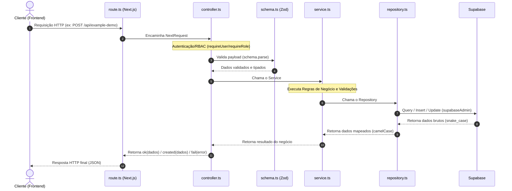

# 📘 Guia Rápido: Padrão Rota ➔ Controller ➔ Service ➔ Repository

Este guia documenta o padrão de arquitetura backend adotado no projeto **AmeMais** (`apps/api`). Nossa arquitetura segue o padrão **Layered Feature-based** (camadas organizadas por funcionalidade). 

Para mais detalhes sobre a justificativa de design, veja a [ADR 0002 — Arquitetura do backend](../../../../docs/decisions/0002-arquitetura-backend-layered-feature-based.md).

---

## 🧭 Fluxo da Requisição (Visão Geral)

Toda requisição HTTP recebida pela API segue um caminho unidirecional e rígido através das camadas:



---

## 📂 As 5 Camadas Detalhadas

Cada pasta de funcionalidade dentro de `src/features/<feature>/` encapsula suas camadas, exceto a rota HTTP que fica mapeada no App Router do Next.js.

### 1. Rota (`route.ts`)
* **Localização**: `apps/api/app/api/<nome-da-feature>/route.ts`
* **Responsabilidade**: Ponto de entrada HTTP do Next.js. Funciona apenas como um "fio condutor" e deve ser o mais fino possível.
* **O que faz**:
  * Importa e exporta os verbos HTTP correspondentes (`GET`, `POST`, `PUT`, `DELETE` etc.) mapeados para funções do **Controller**.
  * Exporta a resposta do preflight do CORS (`OPTIONS = corsPreflightResponse`).
  * Não contém lógica de negócio, autenticação, nem regras de tratamento de erro.
* **Referência Viva**: [app/api/example-demo/route.ts](../../app/api/example-demo/route.ts)

### 2. Schema (`schema.ts`)
* **Localização**: `apps/api/src/features/<feature>/schema.ts`
* **Responsabilidade**: Validação e tipagem de entrada/saída de dados.
* **O que faz**:
  * Utiliza a biblioteca **Zod** para definir esquemas de validação de dados em runtime.
  * Exporta tipos TypeScript inferidos (`z.infer<typeof schema>`) para serem usados pelo Controller, Service e Repository.
* **Referência Viva**: [_example-demo/schema.ts](./_example-demo/schema.ts)

### 3. Controller (`controller.ts`)
* **Localização**: `apps/api/src/features/<feature>/controller.ts`
* **Responsabilidade**: Adaptador de Protocolo (HTTP). Traduz a requisição HTTP em chamadas de serviço e formata a resposta.
* **O que faz**:
  * **Autenticação e RBAC**: Chama `requireUser(request)` ou `requireRole(request, roles)` logo na primeira linha para garantir segurança (ver [middleware/auth.ts](../middleware/auth.ts) e [middleware/rbac.ts](../middleware/rbac.ts)).
  * **Extração**: Extrai dados da requisição (`request.json()`, `request.nextUrl.searchParams` etc.).
  * **Validação**: Valida a estrutura dos dados usando o schema do Zod (`schema.parse()`).
  * **Invocação**: Repassa os dados validados e tipados para o **Service**.
  * **Resposta HTTP**: Formata as respostas de sucesso e captura erros em um bloco `try-catch`, enviando-os para os formatadores globais em [core/http.ts](../core/http.ts) (`ok()`, `created()`, `fail()`).
* **Referência Viva**: [_example-demo/controller.ts](./_example-demo/controller.ts)

### 4. Service (`service.ts`)
* **Localização**: `apps/api/src/features/<feature>/service.ts`
* **Responsabilidade**: Regras de Negócio e Orquestração. É o "coração" da funcionalidade.
* **O que faz**:
  * É **completamente isolado do HTTP** (nunca importa `NextRequest`, `NextResponse` ou manipula headers/status codes).
  * Executa a lógica de negócio principal do sistema (validações de domínio, cálculos, fluxos condicionais).
  * Orquestra a persistência de dados chamando um ou mais métodos do **Repository**.
  * Dispara efeitos colaterais como envio de e-mails, notificações e integrações externas.
  * Lança erros de aplicação específicos (`ValidationError`, `NotFoundError` etc., importados de [core/errors.ts](../core/errors.ts)) caso alguma regra seja violada.
* **Referência Viva**: [_example-demo/service.ts](./_example-demo/service.ts)

### 5. Repository (`repository.ts`)
* **Localização**: `apps/api/src/features/<feature>/repository.ts`
* **Responsabilidade**: Acesso a Dados (Supabase).
* **O que faz**:
  * **Única camada autorizada** a importar o `supabaseAdmin` e interagir diretamente com o banco de dados.
  * Executa queries, inserts, updates e deletes nas tabelas.
  * Captura erros internos do banco e os propaga.
  * **Mapeamento de Dados (Camada Anti-Corrupção)**: Converte as colunas do banco de dados (que usam `snake_case`) para as propriedades camelCase esperadas pelo TypeScript e frontend.
* **Referência Viva**: [_example-demo/repository.ts](./_example-demo/repository.ts)

---

## 🛡️ Gestão de Erros Padronizada

Para evitar que a API retorne erros inconsistentes, a captura é centralizada via a função `fail(error)` de [core/http.ts](../core/http.ts). 

### Como lançar erros na prática (Camadas Service ou Repository):
```typescript
import { NotFoundError, ValidationError } from "@/core/errors";

// Exemplo no Service:
if (!animal) {
  throw new NotFoundError("Animal"); // Retornará HTTP 404 automaticamente
}

if (idade < 0) {
  throw new ValidationError("A idade do animal não pode ser negativa"); // Retornará HTTP 400 automaticamente
}
```

O helper `fail(error)` trata isso da seguinte forma:
1. **`AppError`** (ex: `NotFoundError`, `ForbiddenError`): Retorna a mensagem do erro com o código HTTP adequado (404, 403, 401, 400).
2. **`ZodError`** (validação de entrada): Retorna HTTP 400 com a mensagem `"Dados inválidos"` e uma lista detalhada dos campos que falharam (`issues`).
3. **Erros desconhecidos** (ex: erro de rede ou sintaxe do banco): Loga o erro no console (`console.error`) e retorna HTTP 500 com a mensagem genérica `"Erro interno"`.

---

## 📝 Passo a Passo: Criando uma Feature Nova do Zero

Ao receber a tarefa de criar uma funcionalidade nova (ex: `cadastro-vacinas`), siga esta receita de bolo:

1. **Defina os Contratos (`schema.ts`)**
   * Crie a pasta `src/features/cadastro-vacinas/`.
   * Crie o arquivo `schema.ts`.
   * Escreva o schema Zod para validação da vacina e exporte o tipo correspondente.

2. **Implemente o Repositório (`repository.ts`)**
   * Crie o arquivo `repository.ts`.
   * Escreva as queries Supabase necessárias.
   * Lembre-se de mapear as colunas retornadas de `snake_case` para `camelCase`.

3. **Escreva as Regras no Serviço (`service.ts`)**
   * Crie o arquivo `service.ts`.
   * Implemente as validações e regras de negócio.
   * Chame o repositório para salvar ou recuperar as informações.
   * *Opcional: Crie testes unitários para o serviço no arquivo `service.test.ts`*.

4. **Prepare o Adaptador HTTP (`controller.ts`)**
   * Crie o arquivo `controller.ts`.
   * Adicione a validação de perfil/usuário necessária na primeira linha (`requireUser`/`requireRole`).
   * Extraia o body ou query parameters, valide com o Zod schema, e chame o service.
   * Envolva tudo em um `try-catch` retornando as funções HTTP padronizadas.

5. **Exponha a Rota (`route.ts`)**
   * Crie a pasta da rota em `app/api/cadastro-vacinas/`.
   * Crie o arquivo `route.ts`.
   * Importe as funções do controller e associe aos verbos HTTP (`GET`, `POST` etc.).
   * Não se esqueça de expor o CORS OPTIONS.
