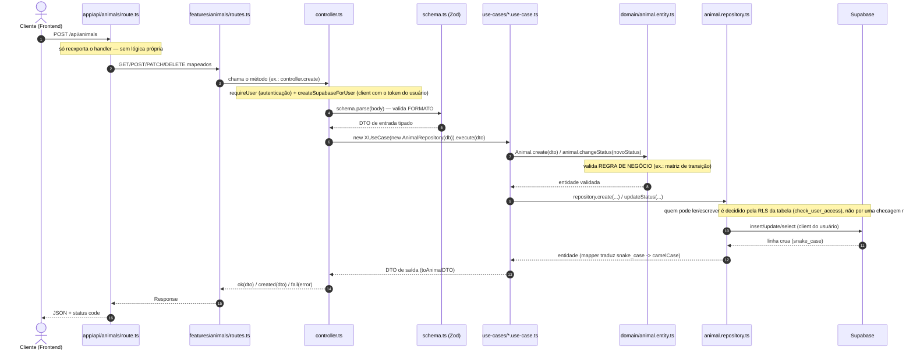

# 📘 Guia rápido: padrão Route ➔ Controller ➔ UseCase ➔ Repository

Cada feature de `apps/api` segue o mesmo padrão, com tudo morando dentro da própria pasta da feature — nenhuma pasta compartilhada tipo `controllers/`, `usecases/` etc. no nível do projeto.

Guia completo (com o "por quê" de cada peça, SOLID, DDD, padrões de projeto) em [`docs/guia-arquitetura-backend.md`](../../../../docs/guia-arquitetura-backend.md). Exemplo vivo: [`features/animals`](./animals).

---

## Fluxo da requisição



---

## As peças, por arquivo

| Arquivo | Papel |
| --- | --- |
| `apps/api/app/api/<feature>/route.ts` | Só reexporta `routes.ts` da feature. Existe porque o App Router do Next.js só reconhece rota via arquivo físico em `app/`. Zero lógica. |
| `routes.ts` | Tabela de endpoints: verbo HTTP → método do controller. |
| `controller.ts` | Classe, 1 método por endpoint. Autentica (`requireUser`), monta um client Supabase com o token do usuário (`createSupabaseForUser` — a RLS da tabela decide o que ele pode fazer), valida **formato** com Zod, instancia `new XUseCase(new XRepository(db))`, formata resposta (`ok`/`created`/`fail`). |
| `schema.ts` | Schemas Zod — os tipos inferidos são os DTOs de entrada. |
| `use-cases/*.use-case.ts` | 1 classe por ação (`CreateXUseCase`, `ListXUseCase`...), repository injetado no construtor. Aciona a entidade, nunca reimplementa regra de negócio. |
| `domain/*.entity.ts` | Entidade: identidade + estado privado + métodos que protegem as invariantes (ex.: `Animal.changeStatus()`). |
| `domain/*.vo.ts` | Value Object, quando um campo carrega regra própria (ex.: `AnimalStatus` — imutável, autovalidado, sabe se pode transicionar). |
| `mapper.ts` | Único lugar que sabe o nome das colunas do banco — traduz linha (`snake_case`) ↔ entidade (`camelCase`). |
| `<x>.dto.ts` | Contrato de saída exato da API, montado pelo use case a partir da entidade. |
| `<x>.repository.ts` | Única camada que fala com o Supabase. Interface (`IXRepository`) + implementação — não sabe nada de HTTP/auth. |

`dto`, `repository` e `use-cases` só viram pasta quando têm mais de um arquivo — com 1 só, ele mora solto na raiz da feature (é o caso de `animal.dto.ts` e `animal.repository.ts` hoje).

---

## Erros

Toda camada lança uma subclasse de `AppError` ([`core/errors.ts`](../core/errors.ts)) — nunca `Error` genérico, nunca a mensagem crua de um erro de infra:

```ts
throw new NotFoundError("Animal");           // 404
throw new ValidationError("nome inválido");  // 400
throw new DatabaseError(erroDoSupabase);     // 500 — mensagem pública fixa, erro real só em `cause` (log)
```

`fail(error)` em [`core/http.ts`](../core/http.ts) centraliza a tradução pra resposta HTTP e loga (com `cause`) todo erro 5xx.

---

## Criando uma feature nova

1. `domain/<x>.entity.ts` (+ `<x>-status.vo.ts` se algum campo tiver regra própria).
2. `schema.ts` — schemas Zod de entrada.
3. `mapper.ts` — linha do banco ↔ entidade.
4. `<x>.dto.ts` — contrato de saída.
5. `<x>.repository.ts` — interface `IXRepository` + implementação Supabase.
6. `use-cases/*.use-case.ts` — 1 classe por ação.
7. `controller.ts` — 1 método por endpoint.
8. `routes.ts` — mapeia verbo HTTP → método do controller.
9. `apps/api/app/api/<feature>/route.ts` (+ `[id]/route.ts` se precisar) — só reexporta `routes.ts`.

Copie a estrutura de [`features/animals`](./animals) e adapte.
